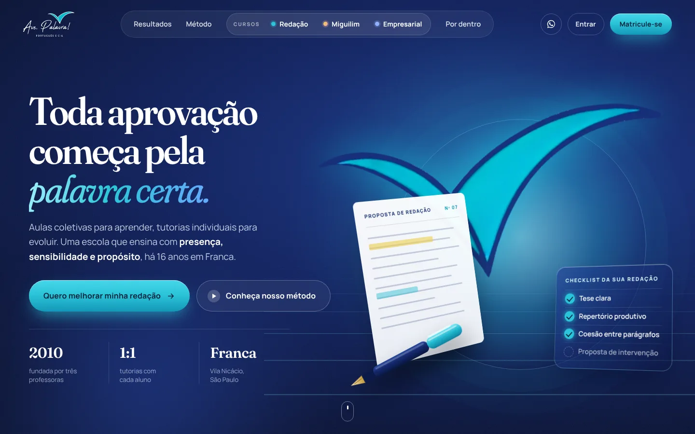
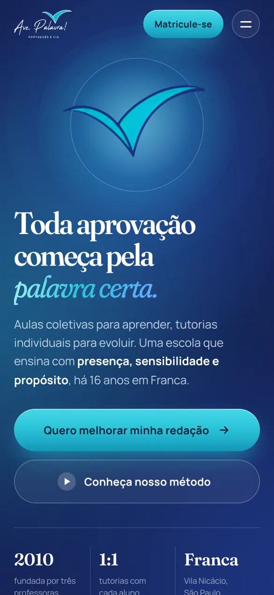

# Ave, Palavra! — site institucional

[](https://github.com/IgorCruz-dev/ave-palavra-site/actions/workflows/ci.yml)
[](https://nextjs.org/)
[](tsconfig.json)
[](#acessibilidade-e-movimento)

**Site institucional da Ave, Palavra! Português e Cia, escola de redação e
língua portuguesa em Franca/SP, feito para converter visitantes em matrículas
sem depender de servidor, banco ou CMS.**

<p align="center">
  
  &nbsp;
  
</p>

> Projeto feito sob encomenda para um cliente real. O código é público como
> portfólio; marca, textos e imagens pertencem à escola (veja [Licença](#licença)).

## Destaques

| | |
|---|---|
| **Exportação estática** | `next build` gera HTML/CSS/JS puro em `out/`: hospeda em qualquer lugar, custo zero, nada para cair |
| **Conteúdo tipado** | Todo texto, imagem e CTA vive em um único arquivo (`src/content/site.ts`) validado pelo TypeScript |
| **Acessível** | Contraste AA, um `<h1>` por página, navegação por teclado e respeito a `prefers-reduced-motion` |
| **Leve** | Imagens em WebP com `srcset`, fontes auto-hospedadas, sem dependências de runtime além do React |
| **Integrado à StudyTrack** | O portal do aluno e a matrícula apontam para a plataforma [StudyTrack](https://github.com/kauaguerrero/studytrack-frontend) |

## Stack

| Camada | Tecnologia |
|---|---|
| Framework | Next.js 16 (App Router, `output: 'export'`) |
| Linguagem | TypeScript |
| Estilo | CSS puro com escopo em `[data-org-site]` |
| Qualidade | ESLint (`eslint-config-next`), `tsc --noEmit`, CI no GitHub Actions |

## Decisões técnicas

- **Estático em vez de SSR ou CMS.** O conteúdo muda poucas vezes por ano.
  Um site estático elimina servidor, banco e painel, e com isso custo,
  manutenção e superfície de ataque. Editar continua simples: um arquivo.
- **Conteúdo como código tipado.** Em vez de JSON solto, `site.ts` segue o
  contrato de `types.ts`: um campo esquecido quebra o `typecheck` antes de ir ao
  ar, não a página em produção.
- **Textos que não envelhecem.** `{years}` é calculado a partir do ano de
  fundação na hora do build: nada de "há 16 anos" desatualizado.
- **Privacidade por padrão.** Depoimentos sem nome, foto ou ano; só entram com
  autorização (e dos responsáveis, no caso de menores).

## Rodar

```bash
npm install
npm run dev        # desenvolvimento em http://localhost:3000
npm run build      # gera out/
npm start          # serve out/ localmente, para conferir o resultado final
npm run typecheck
```

## Editar o conteúdo

Tudo vive em **`src/content/site.ts`**: textos, imagens, depoimentos, telefones,
endereço, CTAs. Edite, rode `npm run build` e publique. O arquivo é tipado — se
um campo não existir ou estiver no formato errado, `npm run typecheck` acusa
antes de ir para o ar.

Pontos que vale conhecer:

- **`{years}`** é substituído pelos anos desde `hero.founded_year` na hora de
  renderizar. Nunca escreva "há 16 anos" fixo; o texto envelheceria sozinho.
- **`is_example: true`** marca o que é demonstração, não resultado real. Os
  selos amarelos "Exemplo ilustrativo" saíram a pedido da escola. A folha de
  redação de Resultados (nota 960) é ilustrativa e aparece sem aviso — o ideal
  é trocá-la por uma redação real e autorizada. O painel do Método se chama
  "Exemplo de correção" enquanto for demonstração.
- **Mural de aprovações**: está oculto porque `results.approvals.items` está
  vazio. Preencha a lista e mude `placeholder_when_empty` se quiser exibi-lo.
- **Depoimentos** (`inside.testimonials`): publique apenas com autorização de
  quem escreveu — e dos responsáveis, se for menor de idade. Hoje estão sem
  nome, foto, curso ou ano, de propósito: menos dado pessoal exposto, mesma
  mensagem.
- **Vídeos**: cada card de `inside` aceita `video_url` (toca na própria página,
  em lightbox) ou `external_url` (abre o Instagram). Coloque os arquivos em
  `public/videos/` e aponte `video_url` para `/videos/arquivo.mp4`.

## Imagens

`public/img/` — já em WebP, nos tamanhos servidos. O herói está sem foto (a ave
da logomarca é a protagonista). Para voltar a ter uma, preencha `hero.person`
com uma foto natural, recortada sem fundo, em três larguras (480/800/1200) para
o `srcset`: ela vira o maior elemento da primeira tela.

`og-1200x630.jpg` é o card de compartilhamento do WhatsApp e das redes.

## Estrutura

```
src/
  app/            layout (metadados, Open Graph) e a página
  components/
    SiteTemplate.tsx   monta as seções
    sections/          nav, herói, resultados, método, por dentro, matrículas, rodapé
    primitives.tsx     revelação ao rolar, parallax, tilt, lightbox, botões
    premium-v1.css     todo o estilo, sob [data-org-site]
    fonts.ts           Fraunces, Manrope e Caveat, auto-hospedadas
  content/
    site.ts       o conteúdo (edite aqui)
    types.ts      o formato do conteúdo
    helpers.ts    tema, CTAs, {years}
```

## Acessibilidade e movimento

Com `prefers-reduced-motion: reduce` o site desliga flutuação, parallax, tilt,
o "chão" animado e as revelações — o conteúdo aparece de imediato, no lugar
final. A opacidade zero da revelação só vale quando há JavaScript e o usuário
não pediu redução de movimento; sem isso o pior caso é "sem animação", nunca
uma página em branco.

## Fontes

Fraunces, Manrope e Caveat, todas sob SIL Open Font License, auto-hospedadas em
`public/fonts/`.

## Licença

Código público **apenas como portfólio**: todos os direitos reservados (veja
[LICENSE](LICENSE)). Marca, textos e imagens pertencem à Ave, Palavra!
Português e Cia.

## Autor

Desenvolvido por **Igor Cruz** · [igorcruz.com.br](https://igorcruz.com.br) ·
[GitHub](https://github.com/IgorCruz-dev)
